# lmfilament

**Drive [Google Filament](https://github.com/google/filament) from LMScript with one static executable.**

lmfilament is a native host for the lmscript `_dsl_` statement. It embeds Filament 1.78.1 (material compiler,
engine, geometry tools) and exposes it through [`schema/lmfilament.dsl.json`](schema/lmfilament.dsl.json),
the same way [lmhtml](https://github.com/lmctl-ai/lmhtml) and [lmcad](https://github.com/lmctl-ai/lmcad) do.
The binary has no runtime dependency.

```lms
p = _dsl_ cli="lmfilament" install="github:lmctl-ai/lmfilament@latest";
let mat = fil.material_file("third_party/filament/samples/materials/aiDefaultMat.mat");
mat.set_float3("baseColor", 0.8, 0.8, 0.8);
mat.set_float("metallic", 1.0);
let s = fil.scene();
s.add_at(fil.mesh_obj("third_party/filament/assets/models/monkey/monkey.obj"), mat, 0.0, 0.0, -4.0);
s.directional_light(0.9551, 0.8276, 0.7678, 110000.0, 0.7, -1.0, -0.8);
s.render_frames(2);
end _dsl_
```

## What it does (and does not)

Real: `.mat` -> `.filamat` compilation (all upstream sample materials), Filament engine/scene/camera/light/
renderable/material-instance objects, procedural meshes, OBJ import/export, tangent frames.
Not real: **Filament pixels**. A fully static binary cannot load a GPU driver, so Filament runs on its noop backend
and `render_frames` drives the render loop without output. The pictures below come from lmfilament's own small CPU
preview rasterizer (`Scene.render_png`): Lambert shading from the scene's lights, `baseColor` from the material
parameters, unlit vertex colors, no textures, no shadows. It is a preview, not Filament's PBR renderer.
See [durable-memory/](durable-memory/).

## Examples

Each picture is produced by a self-contained `.lms` port of an upstream Filament C++ sample of a [Magnum Python example](https://doc.magnum.graphics/python/examples/), or of an [lmblender](https://github.com/lmctl-ai/lmblender) / [lmcad](https://github.com/lmctl-ai/lmcad) scene in
[`examples/`](examples) (materials are inlined, so the `lmctl autorun` command in each caption runs from any
directory and writes `images/<name>.png`). `examples/render-all.sh` regenerates all of them; the two Suzanne examples
read the OBJ from a Filament checkout (`scripts/sync-filament.sh`).
[`durable-memory/06-upstream-sample-map.md`](durable-memory/06-upstream-sample-map.md) says what each port keeps.
`strobecolor`, `point_sprites` and `compile-sample-materials` produce no picture.

| Vertex-colored triangle | Suzanne, PBR `aiDefaultMat` | Suzanne, `texturedLit` |
| --- | --- | --- |
| 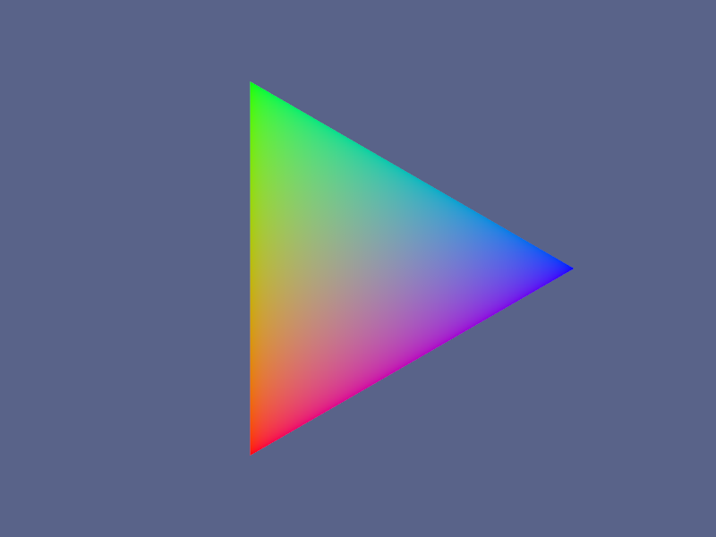 |  | 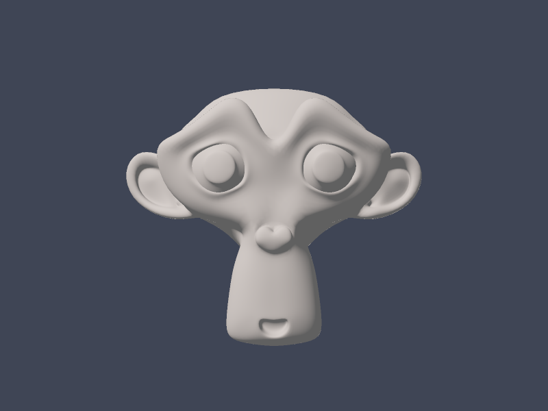 |
| Upstream hellotriangle: unlit `bakedColor` material<br>`lmctl autorun https://raw.githubusercontent.com/lmctl-ai/lmfilament/main/examples/hellotriangle.lms` | Metallic 1, roughness 0.4, sun light (needs a clone for the OBJ)<br>`lmctl autorun https://raw.githubusercontent.com/lmctl-ai/lmfilament/main/examples/hellopbr.lms` | Same scene with the textured material (textures not wired yet; needs a clone)<br>`lmctl autorun https://raw.githubusercontent.com/lmctl-ai/lmfilament/main/examples/suzanne.lms` |

| Primitives | Primitives, using a scene graph | Model viewer |
| --- | --- | --- |
| 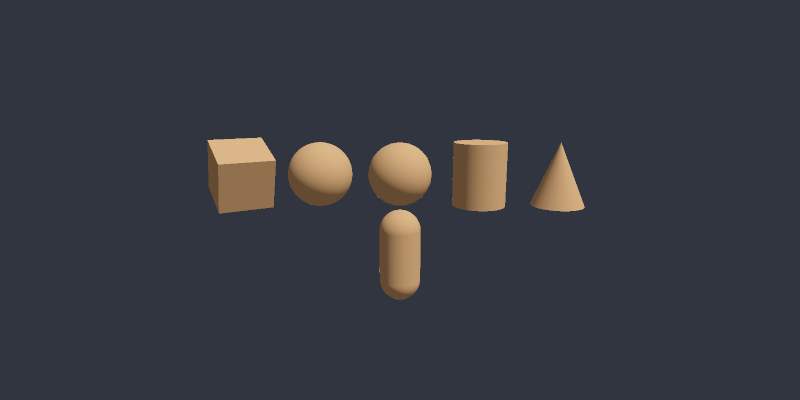 | 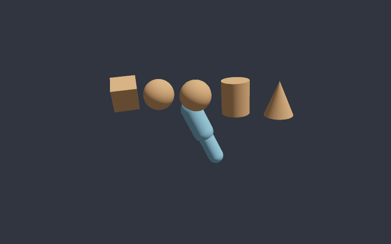 | 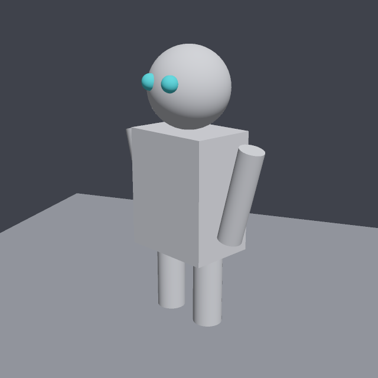 |
| Magnum Python example: box, sphere, icosphere, cylinder, cone, capsule<br>`lmctl autorun https://raw.githubusercontent.com/lmctl-ai/lmfilament/main/examples/primitives.lms` | Magnum Python example: parts parented to nested `Node`s (Filament TransformManager)<br>`lmctl autorun https://raw.githubusercontent.com/lmctl-ai/lmfilament/main/examples/primitives-scene-graph.lms` | Magnum Python example: a posed robot under one scene-graph node<br>`lmctl autorun https://raw.githubusercontent.com/lmctl-ai/lmfilament/main/examples/model-viewer.lms` |

| Text | Depth testing | Vertex buffer layout |
| --- | --- | --- |
| 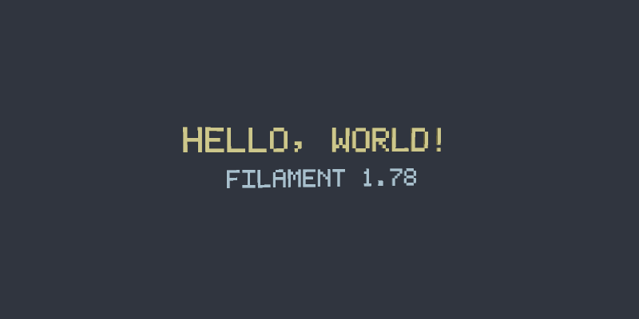 | 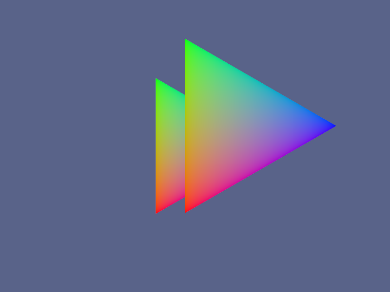 | 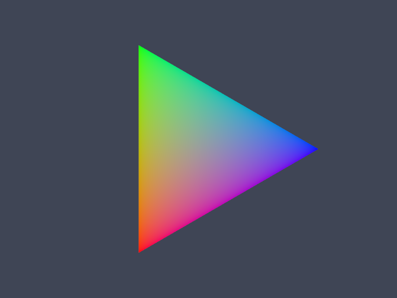 |
| Magnum Python example: voxel text from a 5x7 font<br>`lmctl autorun https://raw.githubusercontent.com/lmctl-ai/lmfilament/main/examples/text.lms` | Two triangles at different depths; the nearer one wins<br>`lmctl autorun https://raw.githubusercontent.com/lmctl-ai/lmfilament/main/examples/depthtesting.lms` | Position + packed ubyte4 color, `bakedColor`<br>`lmctl autorun https://raw.githubusercontent.com/lmctl-ai/lmfilament/main/examples/vbotest.lms` |

| Blue skybox view | Sun + five point lights | Ground plane and sun |
| --- | --- | --- |
| 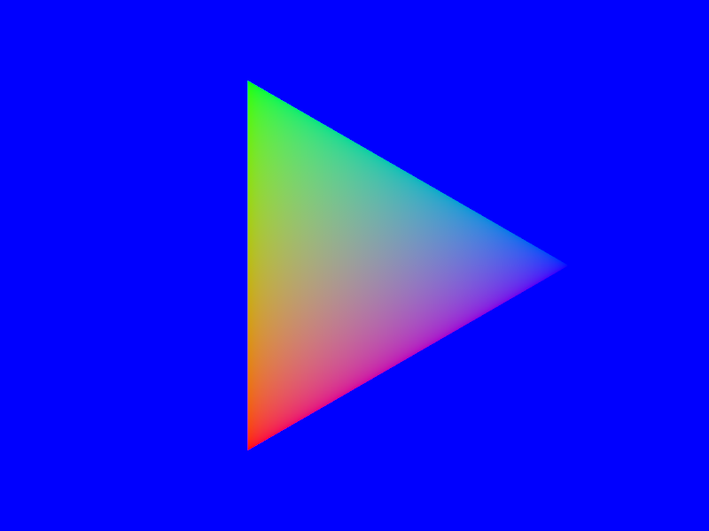 | 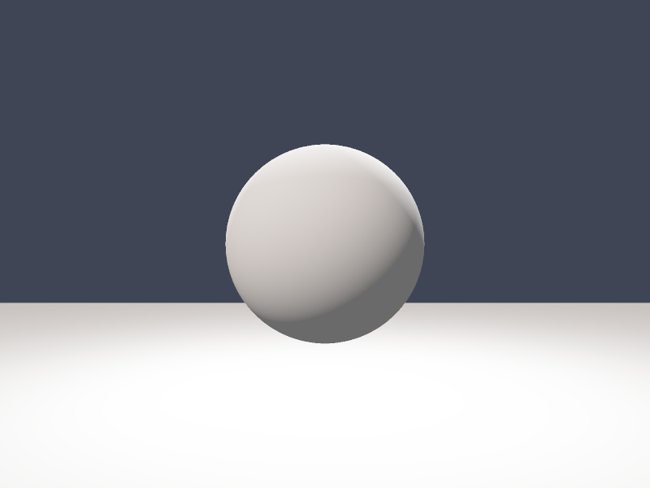 | 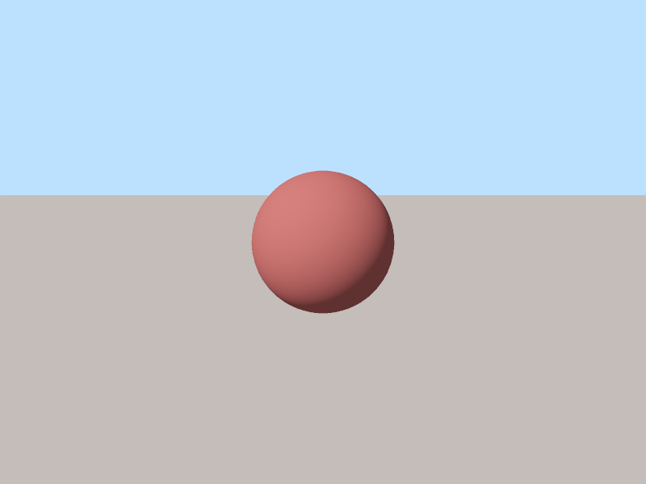 |
| Triangle on a pure blue skybox<br>`lmctl autorun https://raw.githubusercontent.com/lmctl-ai/lmfilament/main/examples/viewtest.lms` | Metal sphere over a ground plane at the upstream light positions<br>`lmctl autorun https://raw.githubusercontent.com/lmctl-ai/lmfilament/main/examples/lightbulb.lms` | `groundShadow` plane and a lit sphere on a sky-blue skybox<br>`lmctl autorun https://raw.githubusercontent.com/lmctl-ai/lmfilament/main/examples/shadowtest.lms` |

| Material sandbox | Textured quad | Heightfield plane |
| --- | --- | --- |
| 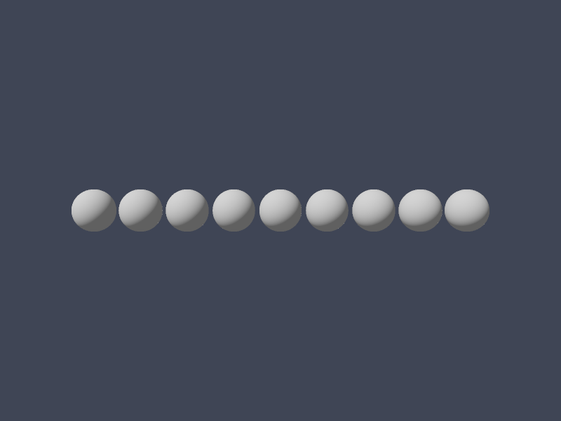 | 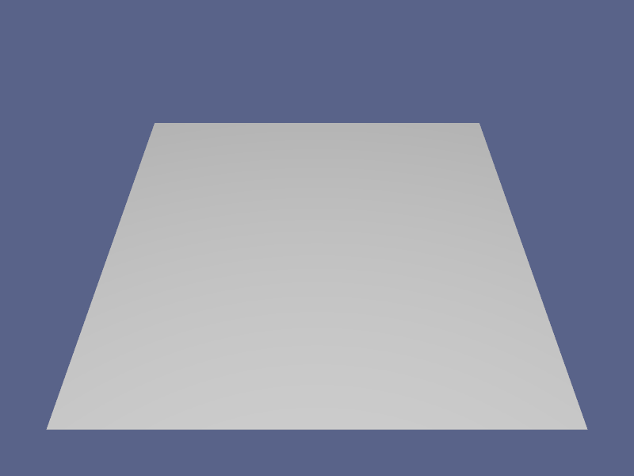 | 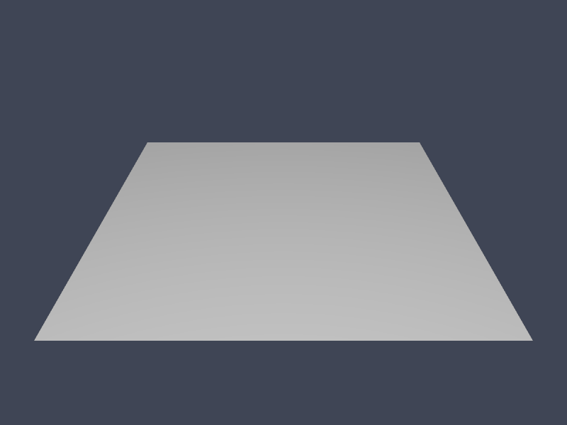 |
| Nine sandbox materials on spheres (lit, fade, transparent, refraction, cloth, ...)<br>`lmctl autorun https://raw.githubusercontent.com/lmctl-ai/lmfilament/main/examples/material_sandbox.lms` | `bakedTexture` quad (texture parameter not wired yet)<br>`lmctl autorun https://raw.githubusercontent.com/lmctl-ai/lmfilament/main/examples/texturedquad.lms` | `heightfield` material on a quad (height texture not wired yet)<br>`lmctl autorun https://raw.githubusercontent.com/lmctl-ai/lmfilament/main/examples/heightfield.lms` |

| Caffeine molecule | Water molecule | Buckminsterfullerene C60 |
| --- | --- | --- |
| 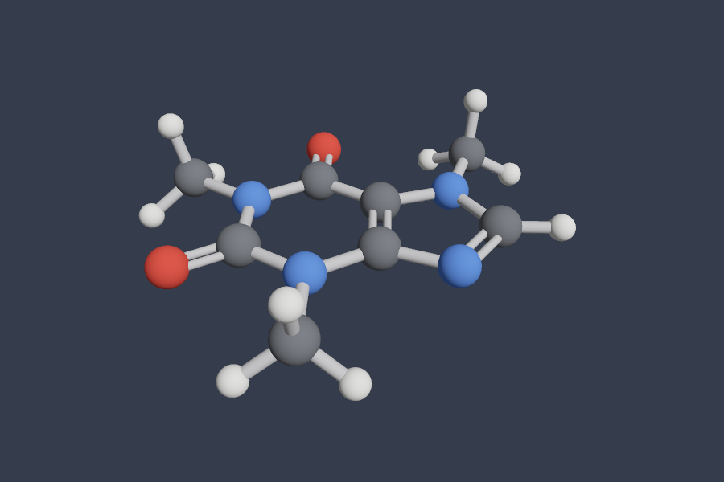 | 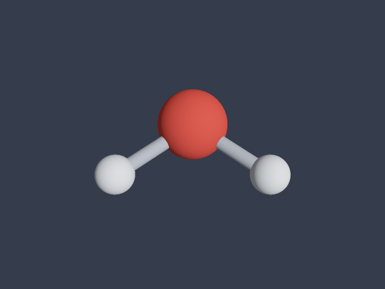 | 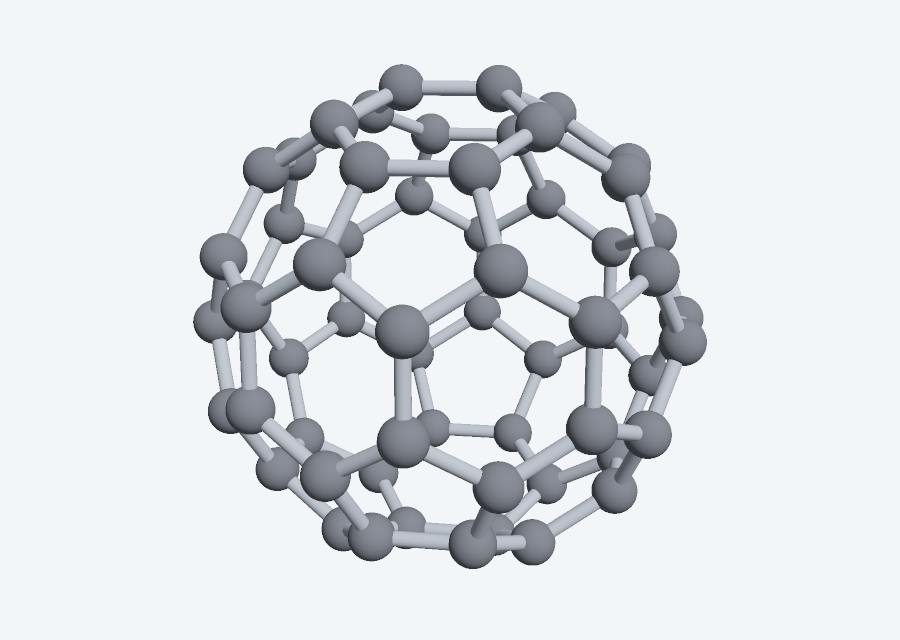 |
| Ball-and-stick, 24 atoms in CPK colours (from lmblender)<br>`lmctl autorun https://raw.githubusercontent.com/lmctl-ai/lmfilament/main/examples/caffeine-molecule.lms` | 104.5 degree H-O-H angle (from lmcad)<br>`lmctl autorun https://raw.githubusercontent.com/lmctl-ai/lmfilament/main/examples/ball-stick.lms` | 60 atoms from icosahedral symmetry, 90 bonds (from lmcad)<br>`lmctl autorun https://raw.githubusercontent.com/lmctl-ai/lmfilament/main/examples/buckyball.lms` |

| B-DNA double helix | Cornell box | Saturn and its rings |
| --- | --- | --- |
| 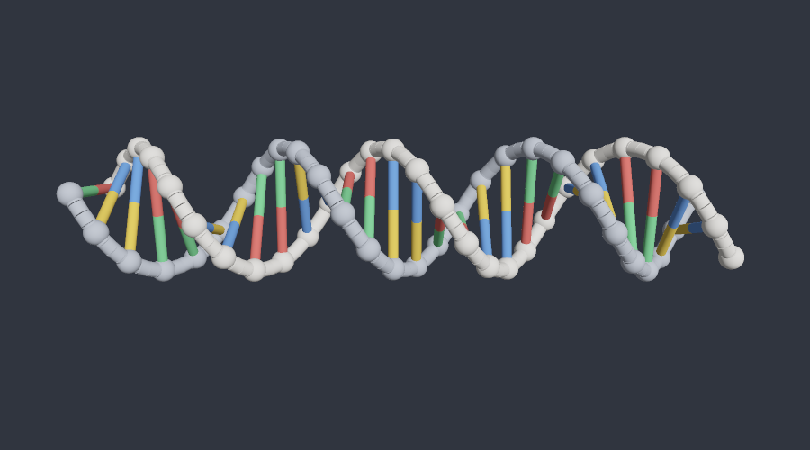 | 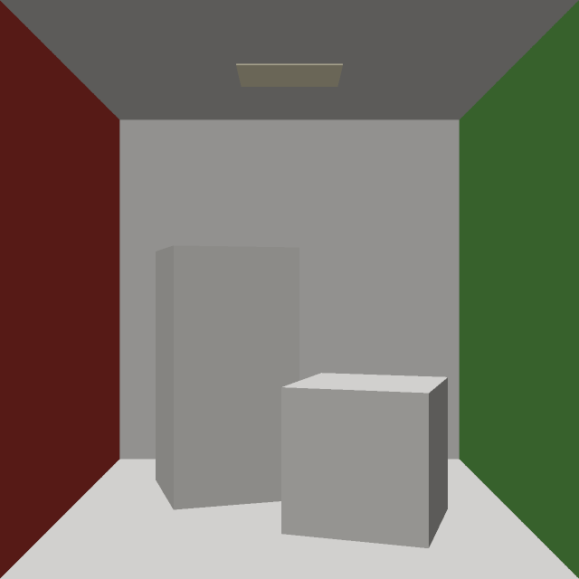 | 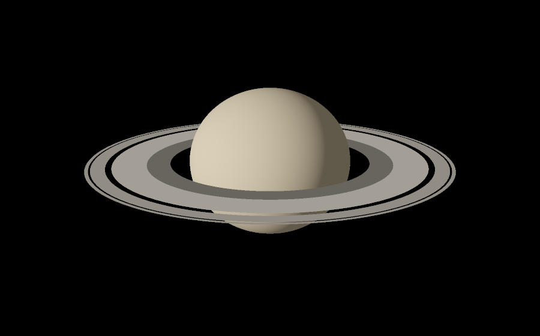 |
| 28 base pairs, 144 degree groove geometry (from lmblender)<br>`lmctl autorun https://raw.githubusercontent.com/lmctl-ai/lmfilament/main/examples/dna-double-helix.lms` | Red and green walls, two white blocks (from lmblender)<br>`lmctl autorun https://raw.githubusercontent.com/lmctl-ai/lmfilament/main/examples/cornell-box.lms` | Ring radii to scale, Cassini Division (from lmblender)<br>`lmctl autorun https://raw.githubusercontent.com/lmctl-ai/lmfilament/main/examples/saturn-rings.lms` |

| Pratt truss footbridge | Shadows | Multi draw |
| --- | --- | --- |
| 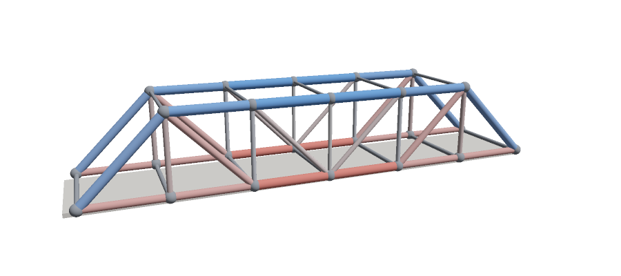 | 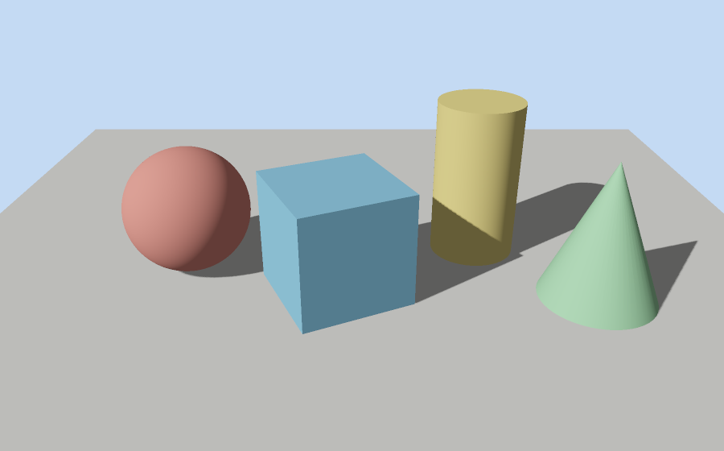 | 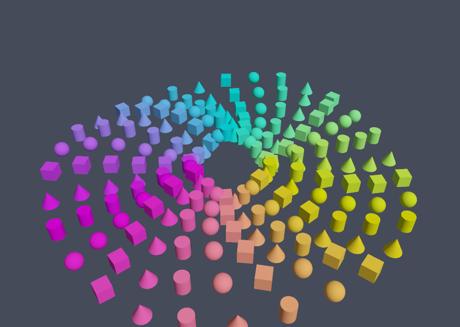 |
| Method of joints: red tension, blue compression (from lmcad)<br>`lmctl autorun https://raw.githubusercontent.com/lmctl-ai/lmfilament/main/examples/truss-bridge.lms` | Floor and four solids with a shadow map<br>`lmctl autorun https://raw.githubusercontent.com/lmctl-ai/lmfilament/main/examples/shadows.lms` | 180 meshes of four kinds in six rings<br>`lmctl autorun https://raw.githubusercontent.com/lmctl-ai/lmfilament/main/examples/multidraw.lms` |

| Cube map | Bullet (analytic) | 3D fluid flow |
| --- | --- | --- |
| 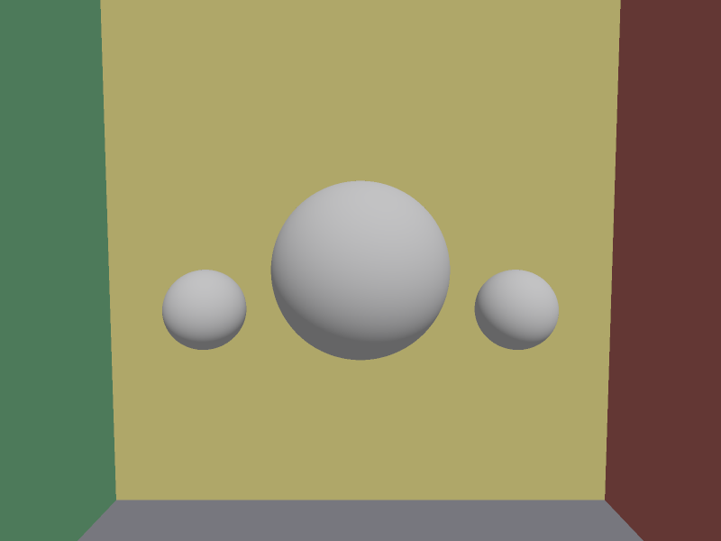 | 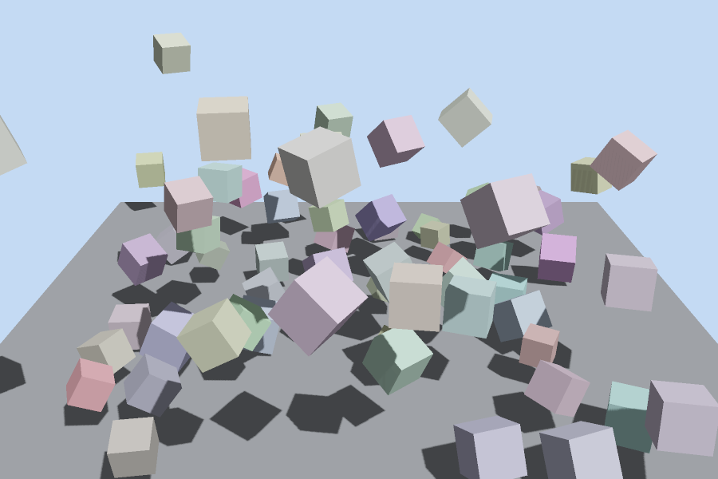 | 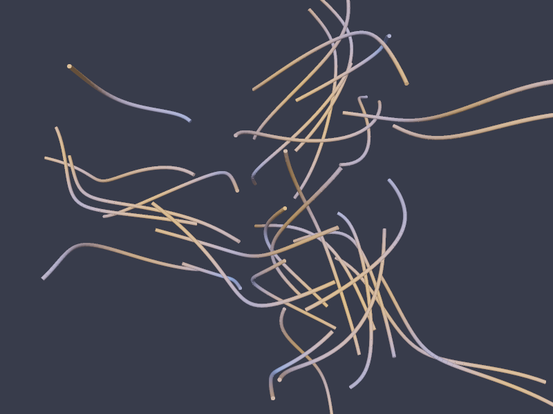 |
| Six-face room around glossy spheres<br>`lmctl autorun https://raw.githubusercontent.com/lmctl-ai/lmfilament/main/examples/cubemap.lms` | 64 boxes falling and bouncing, closed-form ballistics<br>`lmctl autorun https://raw.githubusercontent.com/lmctl-ai/lmfilament/main/examples/bullet.lms` | 32 ABC-flow streamlines coloured by speed<br>`lmctl autorun https://raw.githubusercontent.com/lmctl-ai/lmfilament/main/examples/fluidsimulation3d.lms` |

| 2D fluid flow |   |   |
| --- | --- | --- |
| 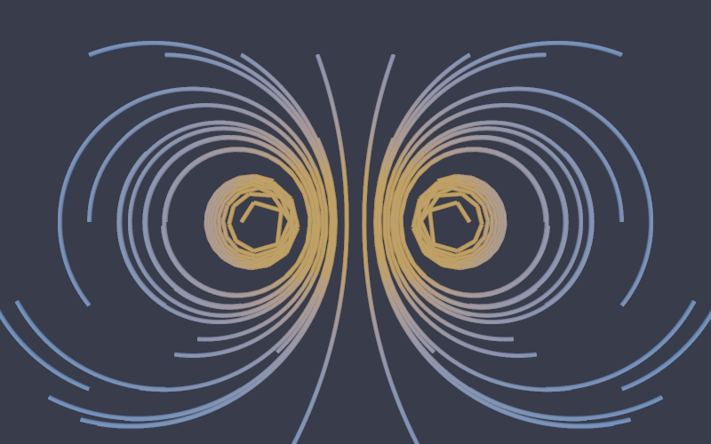 |   |   |
| A counter-rotating vortex pair, 40 streamlines<br>`lmctl autorun https://raw.githubusercontent.com/lmctl-ai/lmfilament/main/examples/fluidsimulation2d.lms` |   |   |

### Homepage clips from lmctl.com

The four 10 s clips on the [lmctl.com](https://lmctl.com) homepage, one per level of the agent-automation ladder. Their scene scripts live in [lmctl-ai/lmctl](https://github.com/lmctl-ai/lmctl/tree/main/scripts/homepage/video); the published videos add lmdraw title and label overlays on top of the 3D scenes shown here. Each example writes 240 frames, then ffmpeg encodes `images/<name>.mp4` and `.gif`; the lmfilament version is a port of the lmcad storyboard (same animation, preview rasterizer, Filament scene graph).

| Level 1: names and teams | Level 2: agents talk through a Lead |
| --- | --- |
| 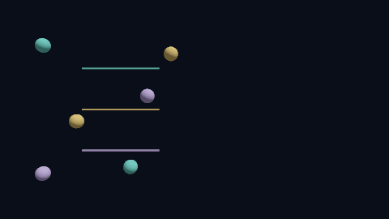 | 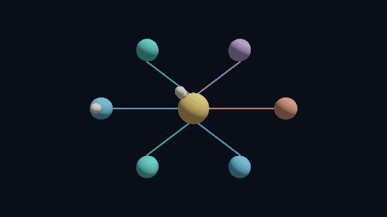 |
| Sessions gather into Lead, Coder and Review rows; a lens inspects one and a usage gauge rises<br>`lmctl autorun https://raw.githubusercontent.com/lmctl-ai/lmfilament/main/examples/level-1-sessions.lms`<br>[MP4](docs/videos/level-1-sessions.mp4) | Provider-coloured agents orbit the Lead; message packets travel through it<br>`lmctl autorun https://raw.githubusercontent.com/lmctl-ai/lmfilament/main/examples/level-2-orchestration.lms`<br>[MP4](docs/videos/level-2-orchestration.mp4) |

| Level 3: a hands-off Lead | Level 4: automation |
| --- | --- |
| 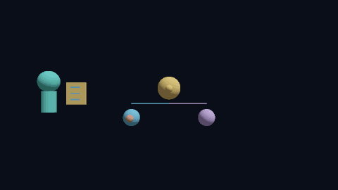 | 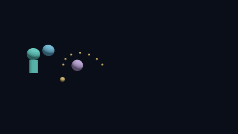 |
| A requirement and its checklist enter; a reviewed result returns<br>`lmctl autorun https://raw.githubusercontent.com/lmctl-ai/lmfilament/main/examples/level-3-hands-off-lead.lms`<br>[MP4](docs/videos/level-3-hands-off-lead.mp4) | A brainstorm becomes a Work, Review, QA and Acceptance pipeline<br>`lmctl autorun https://raw.githubusercontent.com/lmctl-ai/lmfilament/main/examples/level-4-automation.lms`<br>[MP4](docs/videos/level-4-automation.mp4) |

## Build

Needs clang >= 17, cmake, ninja, python3 and `lmscript` (npm `@lmctl-ai/lmctl`).
Details in [`durable-memory/02-build-run-test.md`](durable-memory/02-build-run-test.md).

```sh
scripts/sync-filament.sh      # shallow checkout at filament.lock
scripts/build-filament.sh     # Filament static libs
scripts/build.sh              # build/host/lmfilament
./test.sh
```

## Downloads

Release binaries for Linux (x64, arm64) and macOS (arm64, x64) are on the
[releases page](https://github.com/lmctl-ai/lmfilament/releases). Windows is not supported yet.

## License

MIT, see [LICENSE](LICENSE). Filament is Apache-2.0; see [THIRD_PARTY_NOTICES.md](THIRD_PARTY_NOTICES.md).
